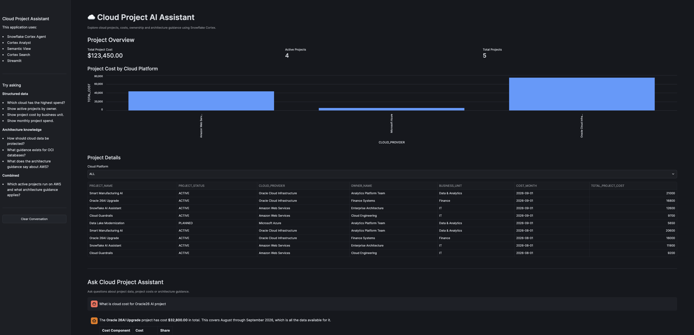
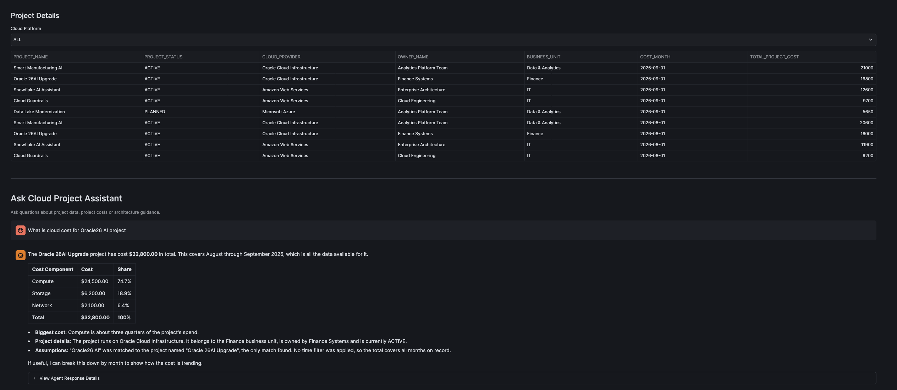

# ☁️ Cloud Project AI Assistant on Snowflake

An end-to-end **Snowflake AI** project that turns raw cloud cost data into a conversational assistant. Business users ask questions in plain English, such as *"Which cloud has the highest spend?"* or *"What does our standard say about encryption?"*, and get governed, accurate answers backed by real data and architecture documents.

The project is a series of hands-on labs. Together they cover the full Snowflake AI stack:

**Data model → Horizon metadata → Semantic View → Cortex Analyst → Cortex Agent → Cortex Search (RAG) → Streamlit app**



---

## 🎯 What I Achieved

- **Built a star-schema data mart** for cloud project costs: projects, cloud providers, owners and monthly compute, storage and network costs.
- **Set up governance with Snowflake Horizon**: table and column comments, classification and ownership tags, a business glossary, metric definitions and view lineage.
- **Wrote a Semantic View** (`PROJECT_ANALYTICS_SV`) that maps business words like *spend*, *hyperscaler* and *sponsor* to physical columns. It includes dimensions, facts, metrics and synonyms.
- **Checked Cortex Analyst against SQL ground truth.** It turned natural-language questions into correct `SEMANTIC_VIEW(...)` SQL.
- **Created a Cortex Agent** (`VALIDATEPROJECTCOST`) in Agent Studio. It decides on its own whether to query structured data or search documents.
- **Added RAG over unstructured knowledge** with a **Cortex Search** service built on architecture and governance documents.
- **Shipped a Streamlit in Snowflake app** with KPIs, a cost-by-cloud chart, a filterable project table and a chat window that calls the agent through `SNOWFLAKE.CORTEX.DATA_AGENT_RUN`.
- **Followed least-privilege RBAC**: a dedicated `PROJECT_ADMIN_ROLE`, an auto-suspending X-Small warehouse and a cleanup script that removes everything.

---

## 🏗️ Architecture

```
                         USER
                          │
                          ▼
                 Streamlit in Snowflake
            (KPIs · charts · chat interface)
                          │
                          ▼
            VALIDATEPROJECTCOST  (Cortex Agent)
                          │
            ┌─────────────┴──────────────┐
            ▼                            ▼
     Cortex Analyst                Cortex Search
            │                            │
            ▼                            ▼
  PROJECT_ANALYTICS_SV        ARCHITECTURE_SEARCH_SERVICE
     (Semantic View)                     │
            │                            ▼
            ▼                  ARCHITECTURE_DOCUMENTS
     VW_PROJECT_COST
            │
            ▼
 FACT_PROJECT_COST ─ DIM_PROJECT ─ DIM_CLOUD ─ DIM_OWNER
```

---

## 🧰 Tech Stack

| Layer | Snowflake feature |
|---|---|
| Compute & security | Virtual Warehouse, RBAC (custom role) |
| Data modeling | Tables, views, star schema |
| Governance | Horizon Catalog: comments, tags, lineage |
| Semantic layer | Semantic Views (YAML via `SYSTEM$CREATE_SEMANTIC_VIEW_FROM_YAML`) |
| Text-to-SQL | Cortex Analyst |
| Retrieval / RAG | Cortex Search (hybrid vector + keyword) |
| Orchestration | Cortex Agents (Agent Studio) |
| UI | Streamlit in Snowflake (Python, Snowpark) |
| Dev assistant | Snowflake Cortex Code (CoCo) |

---

## 📂 Repository Structure

| File | Lab | What it does |
|---|---|---|
| [`LAB01_ENVIRONMENT_CHECK.sql`](LAB01_ENVIRONMENT_CHECK.sql) | Pre-check | Checks user, role, region, Cortex Code limits and available models |
| [`lab1.sql`](lab1.sql) | Lab 1 | Creates the role, database, warehouse and schema, plus grants (Semantic View, Streamlit, Cortex) |
| [`Lab2.sql`](Lab2.sql) | Lab 2 | Builds the physical data mart (dimension and fact tables, sample data) and the `VW_PROJECT_COST` business view |
| [`Lab3.sql`](Lab3.sql) | Lab 3 | Horizon metadata: comments, governance tags, curated analytics view, business glossary and metrics |
| [`Lab4.sql`](Lab4.sql) | Lab 4 | Validates (dry run) and creates the Semantic View with synonyms and business metrics |
| [`PROJECT_ANALYTICS_SV.yaml`](PROJECT_ANALYTICS_SV.yaml) | Lab 4 | Base YAML definition of the Semantic View (the full version with synonyms is in `Lab4.sql`) |
| [`Lab5.sql`](Lab5.sql) | Labs 5–6 | SQL ground truth, Cortex and agent grants, Cortex Analyst tests and agent creation in Agent Studio |
| [`Lab7.sql`](Lab7.sql) | Lab 7 | Architecture document table and the Cortex Search service, which is then added to the agent as a tool |
| [`Lab8.sql`](Lab8.sql) | Lab 8 | First Streamlit app: data table and chat placeholder |
| [`Lab9.sql`](Lab9.sql) | Lab 9 | Full Streamlit app connected to the Cortex Agent |
| [`Cleanup.sql`](Cleanup.sql) | — | Drops the database, warehouse and role |

---

## 🧪 Lab Walkthrough

### Lab 1: Environment Setup
Creates `PROJECT_ADMIN_ROLE`, `SUMEDH_LAB_DB`, the `PROJECT_AI` schema and the `SUMEDH_LAB_WH` warehouse (X-Small, 60 s auto-suspend). It grants only the privileges each later lab needs.

### Lab 2: Physical Data Mart
A star schema with sample data for **5 projects** on **3 clouds** (OCI, AWS, Azure) and **4 owning teams**:

- `DIM_CLOUD`, `DIM_OWNER`, `DIM_PROJECT`
- `FACT_PROJECT_COST`: monthly compute, storage and network cost
- `VW_PROJECT_COST`: a flattened business view with a derived `TOTAL_PROJECT_COST`

### Lab 3: Horizon Context (Governance Metadata)
Without metadata, AI only sees technical names. With it, AI understands what the data means. This lab adds:
- Table and column **comments**
- **Tags**: `DATA_OWNER`, `DATA_CLASSIFICATION` (Internal / Confidential), `BUSINESS_DOMAIN`
- A curated `VW_PROJECT_ANALYTICS` view, which gives **lineage**
- `BUSINESS_GLOSSARY` and `BUSINESS_METRICS` reference tables

### Lab 4: Semantic View
`PROJECT_ANALYTICS_SV` translates business language into SQL:

| Type | Examples |
|---|---|
| Dimensions | Project, Status, Cloud Provider, Region, Owner, Business Unit, Cost Month |
| Facts | Total / Compute / Storage / Network cost |
| Metrics | `TOTAL_CLOUD_COST`, `AVG_PROJECT_COST`, `PROJECT_COUNT`, `ACTIVE_PROJECT_COUNT` |
| Synonyms | *spend, hyperscaler, sponsor, workload, bandwidth cost, …* |

The YAML is first validated with a **dry run** (`TRUE` flag) and then created.

### Labs 5–6: Cortex Analyst & Cortex Agent
I calculated the answers with plain SQL first (**ground truth**), then asked the AI the same questions:

> **Q:** *Which cloud provider has the highest total project cost?*

```sql
SELECT * FROM SEMANTIC_VIEW(
    SUMEDH_LAB_DB.PROJECT_AI.PROJECT_ANALYTICS_SV
    DIMENSIONS cloud_provider
    METRICS total_cloud_cost
) ORDER BY total_cloud_cost DESC NULLS LAST;
```

| Cloud Provider | Total Spend | Share |
|---|---|---|
| Oracle Cloud Infrastructure | $74,400 | 60.27% |
| Amazon Web Services | $43,400 | 35.16% |
| Microsoft Azure | $5,650 | 4.58% |

✅ The AI's answer **matched the SQL ground truth exactly**.

The `VALIDATEPROJECTCOST` agent was then created in **AI & ML → Agent Studio** and connected to the Semantic View.

### Lab 7: Cortex Search (RAG)
Added an `ARCHITECTURE_DOCUMENTS` knowledge base (Encryption Standard, OCI Database Guideline, AWS Network Guideline, FinOps Cost Guideline) and indexed it with `ARCHITECTURE_SEARCH_SERVICE`. After adding it as a tool on the agent:

> **Q:** *What does the lab standard say about encryption?*
>
> **A:** All cloud workloads should encrypt data **at rest and in transit**, with keys managed through each cloud's **native key management service**.

The agent now picks the right tool for each question: **Cortex Analyst** for numbers, **Cortex Search** for guidance.

### Labs 8–9: Streamlit App + Agent Integration
A Streamlit in Snowflake app with:
- **KPI cards**: Total Project Cost **$123,450**, **4** Active Projects, **5** Total Projects
- **Bar chart** of cost by cloud platform
- **Project details table** with a cloud-platform filter
- **Chat assistant** that sends questions to the agent through `SNOWFLAKE.CORTEX.DATA_AGENT_RUN`, keeps conversation history, escapes SQL input safely and has a raw-response expander for debugging



> **Q:** *What is cloud cost for Oracle26 AI project?*
>
> **A:** The agent matched the fuzzy name to **"Oracle 26AI Upgrade"** and returned **$32,800** (Compute 74.7%, Storage 18.9%, Network 6.4%), with owner, business unit and the assumptions it made.

---

## 🚀 How to Run

**Prerequisites:** a Snowflake account in a region where Cortex is available, and access to `SECURITYADMIN`, `SYSADMIN` and `ACCOUNTADMIN` for the one-time grants.

1. Run `LAB01_ENVIRONMENT_CHECK.sql` to confirm your role, region and available models.
2. Run `lab1.sql`. Replace `YOUR_USER_NAME` with your Snowflake username first.
3. Run `Lab2.sql` → `Lab3.sql` → `Lab4.sql` in order.
4. Run `Lab5.sql`, then create the agent in **AI & ML → Agent Studio** (name it `VALIDATEPROJECTCOST`) and connect it to `PROJECT_ANALYTICS_SV`.
5. Run `Lab7.sql`, then add `ARCHITECTURE_SEARCH_SERVICE` to the agent under **Configuration → Tools**.
6. Create a Streamlit app under **Projects → Streamlit** and paste in the Python code from the comment block in `Lab9.sql`.
7. When you're done, run `Cleanup.sql` to remove every lab object.

### 💬 Sample questions to try
- *Which cloud has the highest spend?*
- *Show active projects by owner.*
- *Show monthly project spend.*
- *How should cloud data be protected?*
- *What guidance exists for OCI databases?*
- *Which active projects run on AWS and what architecture guidance applies?* (combines both tools)

---

## 📚 Key Learnings

1. **Metadata is what makes AI work.** Comments, tags and synonyms are what let an LLM understand an enterprise schema.
2. **Semantic Views are the contract** between business language and physical data. They keep AI-generated SQL governed and consistent.
3. **Always check AI against SQL ground truth** before trusting it.
4. **Agents combine tools**: structured (Analyst) plus unstructured (Search) gives answers neither tool could give alone.
5. **Everything stays inside Snowflake.** Data, AI models, search and the UI never leave the platform's governance boundary.

---

## 🔮 Future Enhancements
- Load PDF architecture documents from a stage, then parse, chunk and index them with Cortex Search
- Add row-level security and masking policies on cost data
- Stream agent responses and show the generated SQL and citations in the UI
- Add cost forecasting with Snowflake ML functions

---

## 👤 Author

**Sumedh Ambapkar**
GitHub: [@neo09sumedh](https://github.com/neo09sumedh)
